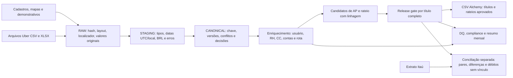

# Análise final do pipeline — Uber for Business → Contas a Pagar

**Corte da análise:** 28/09/2026. A revisão independente em `docs/10_revisao_independente_parecer.md` orientou as correções. As consultas em `docs/11_analise_consultas.py` e `docs/10_revisao_independente_consultas.py` reproduzem os números de negócio; `output/` contém o build corrigido (67/67 tarefas dbt aprovadas) e `reconciliation/` contém o resultado da conciliação bancária, com esquema 2. A primeira competência automatizada está **provisoriamente configurada como setembro/2026**, sujeita à confirmação do cliente para implantação. Nenhum arquivo foi importado no ERP.

## 1. Parecer executivo e escopo financeiro

O pipeline normaliza CSV/XLSX, conserva origem, liga usuários e contas e constrói títulos/rateios com gate por grupo completo. **O build atual exporta zero títulos e zero rateios**: bloqueia julho/agosto pelo corte de competência e títulos com vencimento passado. Os 16 reembolsos anteriormente aptos **não devem ser importados**: o extrato mostra 15 com pagamento PIX e o usuário confirmou lançamento manual no ERP; o décimo sexto, de R$ 146,23, permanece aberto no extrato. As duas faturas Uber foram pagas fora desta integração; o pagamento de agosto tem **R$ 305,27 acima do documento**, com composição ainda a confirmar. O extrato sustenta pagamento bancário, mas a baixa no ERP e a classificação contábil ainda precisam ser conferidas lá.

O total **R$ 31.842,73** é a soma de componentes com BRL conhecido, não o total definitivo devido ou pago. Ele abrange rotas fora desta integração e deixa fora três componentes da rota faturada sem valor seguro. As faturas documentais somam **R$ 29.532,81**; os débitos bancários candidatos a esses boletos somam **R$ 29.838,08**. O extrato não contém identificador do ERP, portanto a baixa operacional deve ser confirmada na fonte contábil antes de alterá-la.

### Ponte de conservação, sem dupla contagem

| Destino mutuamente exclusivo dos 573 candidatos | Candidatos | BRL conhecido | Situação |
|---|---:|---:|---|
| Faturamento Uber | 521 | R$ 29.318,23 | 2 faturas retidas; 3 componentes sem valor seguro |
| Reembolso pessoal aprovado pelo gate antigo | 33 componentes em 16 títulos | R$ 1.363,27 | **Não importar**; 15 com evidência de pagamento PIX e lançamento manual informado pelo financeiro, 1 aberto no extrato |
| Reembolso pessoal retido | 6 componentes em 2 títulos | R$ 245,48 | CPF do beneficiário inválido |
| Cartão AMEX corporativo | 12 | R$ 882,55 | Processo próprio do cartão; fora desta integração |
| Cartão VISA corporativo de destino pendente | 1 | R$ 33,20 | Decisão do cliente; não é reembolso pessoal |
| **Total conhecido** | **573** | **R$ 31.842,73** | Subtotal, pois 3 valores não estão estabelecidos |

Conferências: **R$ 29.318,23 + R$ 1.363,27 + R$ 245,48 + R$ 882,55 + R$ 33,20 = R$ 31.842,73**. As 560 transações das duas primeiras rotas têm um componente e uma linha de linhagem cada; as 13 de cartão corporativo ficam fora do AP desta integração. O gate anterior produzia **16 títulos = 16 linhas de rateio = R$ 1.363,27**. O gate atual retém todos os títulos da amostra; igualdade técnica não provava elegibilidade de implantação. Nenhuma alternativa de transação conflitante foi somada duas vezes.

## 2. Leitura arquitetural de ponta a ponta

| Camada | Grão e persistência | Avaliação |
|---|---|---|
| Entrada/RAW | `raw_files`, `raw_uber_occurrences`, `raw_ref_*`, `input_manifest.json`; bytes deduplicados por SHA-256, localizador CSV/XLSX e originais preservados | Suporta reenvio e auditoria. Há 588 ocorrências Uber e 2 layouts. O extrato está no diretório de entrada, mas não tem tabela bancária de produção. |
| STAGING | `stg_uber_transactions`: 1 linha por ocorrência; datas, moedas, identificadores e `parse_errors`/`technical_changes` | Conserva 588/588 ocorrências. Datas UTC do faturamento e datas locais do reembolso têm bases distintas. Valor ausente continua nulo. |
| CANONICAL | `int_transaction_versions`, `int_transactions`, `int_transactions_resolved`, `int_transaction_conflicts`, `resolution_events` | Chave de transação = viagem + minuto UTC + tipo; não usa valor para decidir duplicidade. 588 versões viram 573 candidatos: 558 únicos, 13 equivalentes, 2 conflitos retidos. Resolução exige ocorrência explícita e conjunto de versões ainda atual. |
| Referências/enriquecimento | `int_uber_email_links`, `dim_internal_user_enrichment`, `int_transaction_enrichment` | Join de e-mail normalizado, inclusive aliases, para usuário interno; matrícula para RH; CC oficial do RH. Cadastro é pré-agregado para impedir multiplicação de dinheiro. Há uma linha de enriquecimento por candidato, inclusive retidos. |
| Classificação/roteamento | Código de despesa → conta contábil postável → crosswalk oficial → conta gerencial postável; método de pagamento → tipo cadastrado de cartão | Não promove sugestão gerencial a regra oficial nem confunde cartão corporativo com pessoal. Departamento e grupo Uber não substituem CC do RH. |
| AP | `int_ap_component_candidates`, `int_ap_title_candidates`, `int_ap_allocation_candidates`, `int_ap_release_gate`, `ap_rateios_linhagem` | Grupo completo é avaliado antes de liberar. Fatura usa demonstrativo por competência UTC; reembolso usa funcionário e mês local. O gate retém competências anteriores ao corte, vencimentos passados e IDs registrados em `raw_issued_titles`; valor alterado vira candidato de ajuste, sem reescrever o título emitido. **O cadastro de títulos emitidos está vazio nesta amostra**, pois não foi fornecida extração do ERP; o bloqueio por competência protege o histórico conhecido. |
| Saída/controle | `ap_titulos.csv`, `ap_rateios.csv`, candidatos retidos, `dq_report.csv`, `dq_normalization_events.csv`, resumos | A saída só substitui a anterior após build e testes dbt; hash do código e dos insumos fica em `run_summary.json`. O build atual tem zero títulos/rateios liberados. |
| Banco | `bank_reconciliation.py`, `reconciliation/bank_reconciliation.csv`, pares, movimentos únicos, revisão e débitos sem vínculo | Lê o extrato separadamente e cruza candidatos de AP, inclusive retidos pelo corte e por CPF, com ocorrências bancárias por hash e linha. Distingue título, principal, duplicado, diferença e bloqueio de importação; não altera o ERP. |

**Critério dos joins.** E-mail, não nome, Employee ID ou grupo Uber, define identidade; matrícula conduz ao empregado; o CC de `funcionarios.xlsx` prevalece sobre o do diretório. Código de despesa liga à conta contábil e somente o crosswalk oficial autoriza a gerencial. Bandeira + quatro dígitos liga ao cadastro de cartões; CNPJ do demonstrativo liga ao fornecedor, evitando o nome Uber duplicado no cadastro. A natureza de cobrança vem da forma de pagamento, enquanto a competência da fatura vem do timestamp UTC. Essas escolhas reduzem falsos rateios e falsos reembolsos.

**Controles fortes observados no build revisado.** O gate retém o **título inteiro** quando qualquer componente, documento, linha de rateio ou estado de emissão falha. Os testes dbt cobrem conservação de população/valor, unicidade, cobertura componente→título, fechamento ao centavo, referências e exclusividade de bucket DQ por código. Valores negativos de ajuste permanecem na base; compliance não altera dívida. Dependências estão fixadas em `requirements.txt`. O build corrigido aprovou **67/67 tarefas dbt**, sem erro ou aviso.

**Correções e limites.** O DQ anterior tinha 399 incidências; após explicitar normalizações e controles, o build atual tem **2.444 incidências: 1.978 `auto_fixable`, 289 `needs_client`, 177 `rule_based`**. Há 1.955 eventos em `dq_normalization_events.csv`, com antes/depois e localizador, incluindo substituição de placeholders, limpeza de texto, e-mail, código, datas, decimais e consolidação de equivalentes; o DQ traz ainda grão, dono e status. Os códigos têm bucket único. Foram adicionados controles de BRL/local, datas impossíveis, RH na data da corrida, reconciliação de fatura, vencimento e rejeição de arquivo desconhecido. A classificação de Custo × Despesa está explicitamente pendente em 71 componentes TRANSP-FUNC/R$ 4.972,40 e nove ENTRE-UN/R$ 327,03, bloqueando título e rateio. Persistem decisões de identidade, comprovantes/encargos, data de emissão e extração de títulos manuais do ERP. O candidato de ajuste não vira título importável enquanto não houver regra aprovada para sua emissão, vencimento e eventuais créditos. A vigência no RH é verificada na data da corrida; o status corrente inativo do diretório não retém sozinho uma corrida histórica válida faturada à empresa. Reembolso de ex-funcionário requer revisão específica.

## 3. Análise de dados, qualidade e negócio

### Competência e evolução

| Competência/base | Faturamento Uber: subtotal conhecido | Fatura documental retida | Reembolso pessoal candidato | Reembolso apto no gate antigo | Reembolso retido no gate antigo |
|---|---:|---:|---:|---:|---:|
| Julho 2026 | R$ 14.409,24; 260 candidatos, 2 disputados | R$ 14.519,26 | R$ 697,58 | R$ 554,90 | R$ 142,68 |
| Agosto 2026 | R$ 14.908,99; 261 candidatos, 1 sem BRL | R$ 15.013,55 | R$ 911,17 | R$ 808,37 | R$ 102,80 |

As demais rotas conhecidas fecham a ponte mensal: em julho, **AMEX R$ 373,85 + VISA pendente R$ 33,20**, resultando em **R$ 15.513,87** de componentes conhecidos; em agosto, **AMEX R$ 508,70** e nenhum VISA pendente, resultando em **R$ 16.328,86**. A soma dos dois meses é **R$ 31.842,73**. O mês da rota faturada é UTC; nos cartões, o resumo usa o mês local da solicitação, que não prova competência contábil do processo do cartão.

O subtotal conhecido do faturamento aumenta **R$ 499,75 (+3,5%)**, mas não autoriza concluir crescimento da **despesa total**: julho tem dois valores disputados e agosto um ausente. A reconciliação por demonstrativo separa cobranças de usuários de taxas administrativas: as diferenças de cobranças são **R$ 110,02** e **R$ 104,56**, as diferenças de taxas são **R$ 0,00** em ambos, e há respectivamente 2 e 1 componentes de cobrança sem valor seguro. Essas diferenças **não são valores a imputar**. Os reembolsos pessoais candidatos sobem **R$ 213,59 (+30,6%)**; são apenas dois meses e 39 corridas, um sinal para investigar frequência, falhas do meio corporativo e política de cartões.

### Onde está o gasto conhecido

Na rota faturada, **CC310 Marketing (R$ 5.225,68; 116 candidatos)**, **CC300 Comercial (R$ 3.566,09; 79)** e **CC210 (R$ 3.421,99; 53)** representam juntos **R$ 12.213,76**, ou **41,7%** do subtotal conhecido. A linha **UNATTRIBUTED** tem **41 candidatos e R$ 2.594,59 (8,9%)**. Sua decomposição é: 21 e-mails não encontrados (R$ 1.370,82), 10 ambíguos (R$ 442,15), quatro CCs inexistentes (R$ 209,70), quatro inativos (R$ 273,92) e duas taxas administrativas sem usuário/CC (R$ 298,00). Regras de identidade com Employee ID como corroboração, se aprovadas pelo cliente, têm potencial de atribuir **25 componentes/R$ 1.472,23**; caixas compartilhadas e consultor externo permanecem pendentes. Não se deve espalhar o restante pelos centros conhecidos.

Por uso na rota faturada, UberX soma **R$ 19.877,14** em 364 candidatos; Eats, **R$ 4.148,66** em 75; Black, **R$ 2.610,84** em 33; Comfort, **R$ 2.383,59** em 47; duas Admin Fees somam **R$ 298,00**. A decomposição fecha **R$ 29.318,23**. Por tipo de transação, 15 ajustes somam **−R$ 493,81** e 10 gorjetas **R$ 39,00**; analisar apenas `Fare` superestimaria o gasto líquido. Estes são valores de componentes, **não** rateios aprovados ou despesa já contabilizada.

### Causas que impedem contabilização e decisões acionáveis

| Prioridade | Evidência | Ação necessária |
|---|---|---|
| 1 — contabilizar faturas já pagas | Ambas carecem de `data_emissao` explícita; 3 componentes têm BRL disputado/ausente; 2 conflitos de chave; 2 Admin Fees/R$ 298,00 sem regra de alocação. Julho tem resíduo de cobranças de R$ 110,02; agosto, R$ 104,56. Os vencimentos já passaram | Conferir/registrar as liquidações no ERP, obter composição de encargos de R$ 305,27 e conta de despesa financeira, resolver valores do detalhe; não preencher resíduo por diferença. |
| 2 — preservar DRE e lucro bruto | TRANSP-FUNC: 71 componentes/R$ 4.972,40, dos quais 68/R$ 4.756,74 em CCs produtivos, hoje apontados para Despesa. ENTRE-UN: 9 componentes/R$ 327,03 em CC300/CC310 não produtivos apontados para Custo. Há ainda 6/R$ 262,52 em conta não postável, 14/R$ 1.003,57 sem código e 2/R$ 87,51 (`PROJ-X`) sem mapa | Controladoria decide Custo × Despesa de TRANSP-FUNC e ENTRE-UN e aprova contas/crosswalk; EVENTO tem divergência gerencial, não contábil. Nenhuma sugestão da origem deve substituir o mapa oficial. |
| 3 — resolver identidade e rateio | 74 e-mails Uber distintos: 68 ligados (62 primários, 6 aliases), 2 ambíguos, 4 não encontrados. Há 41 componentes faturados sem CC atribuível | Corrigir aliases/cadastro por evidência, matrícula e CC oficial; não escolher por nome. Revisar funcionários/CC inativos ou inexistentes. |
| 4 — reembolso e cartões | Dos 16 títulos antigos, 15 têm pagamento PIX compatível e um de R$ 146,23 está aberto; Marcos Tavares teve R$ 73,78 pagos duas vezes e Bianca apresenta diferença de −R$ 0,01. Dois outros reembolsos/R$ 245,48 ficaram retidos por CPF inválido. AMEX/R$ 882,55 segue outro processo; VISA/R$ 33,20 aparece como débito em conta | Não importar julho/agosto; conferir registros manuais no ERP, cobrar/compensar duplicidade, pagar o aberto, investigar o centavo e classificar o VISA. |
| 5 — política de mobilidade | São 75 transações em **72 pedidos Eats**; quatro pedidos excedem R$ 80. Os oito alertas antigos de fim de semana incluem pelo menos uma data impossível e um ajuste; seis incidências de Black fora da diretoria, cinco em Marketing | Recalcular por corrida/pedido (`Fare`), validar datas e encaminhar alertas corretos ao RH. Não deduzir da dívida Uber. |

As **2.444 linhas atuais de DQ são incidências**, não transações distintas; 1.955 são eventos de normalização registrados à parte. No relatório anterior, os 79 registros de crosswalk ausente correspondiam a **77 transações faturadas** (71 TRANSP-FUNC + 6 TREIN) e duas linhas de título; não eram outros meios de pagamento. A parcela `rule_based` inclui eventos informativos com `blocks_stage3=false`; o nome do bucket não significa bloqueio financeiro em todas as linhas. Duas transações têm BRL **R$ 7,70 acima do valor local** cada; há uma data futura de 03/10 em relatório de 01/09 e dois desembarques anteriores à solicitação. Esses cinco casos geram bloqueio de AP, preservam os valores originais e exigem investigação da diferença da fatura de agosto. Há ainda três corridas após desligamento (R$ 173,56) sinalizadas e bloqueadas. A pendência de Custo × Despesa gera 82 incidências DQ, incluindo as de título; o valor de R$ 5.299,43 refere-se aos 80 componentes, sem somar incidências DQ como dinheiro.

## 4. Conciliação bancária e seus limites

O extrato `data/extrato_itau_cc_2026-07_a_2026-09.csv` tem preâmbulo, delimitador `;`, valores brasileiros e registros de saldo misturados a movimentos: **134 linhas, 86 movimentos e 48 saldos** após o cabeçalho. A descrição é truncada em 18 caracteres, há homônimos e não há `id_externo`, CPF ou número do boleto. `bank_reconciliation.py` lê os movimentos separadamente, guarda hash e linha física e cruza os candidatos de AP, inclusive os retidos pelo corte. O aceite automatizado em `tests_bank_reconciliation.py` compara o resultado com o oráculo do parecer:

| Movimento/evidência | Valor | Interpretação com limite explícito |
|---|---:|---|
| Boleto Uber de 10/08 | R$ 14.519,26 | Coincide com a fatura de julho no valor e vencimento |
| Boleto Uber de 11/09 | R$ 15.318,82 | Fatura de agosto R$ 15.013,55 + R$ 305,27; composição de multa/juros ainda é hipótese |
| PIX de reembolso | R$ 1.290,81 em débitos identificados | 12 títulos exatos (R$ 991,34), 1 com −R$ 0,01, 2 títulos de André Moraes em um PIX de R$ 110,40, um aberto (R$ 146,23) e R$ 73,78 pagos em duplicidade |
| `UBER *TRIP` em 23/07 | R$ 33,20 | Compatível com corrida no VISA 0042 em 22/07; classificação contábil pendente |
| **Débitos relacionados encontrados** | **R$ 31.162,09** | R$ 29.838,08 boletos + R$ 1.290,81 PIX + R$ 33,20 cartão |

Não se trata ainda de baixa no ERP. A confirmação dos títulos manuais e dos encargos depende do ERP, comprovantes e retorno da Uber. O valor conhecido dos componentes, o valor do documento e o movimento bancário têm grãos diferentes; **R$ 305,27 não devem ser lançados em uma conta inventada**. A conta de despesa financeira e o de-para gerencial G4.02 exigem aprovação cadastral.

**Estratégia implementada.** O PIX exige prefixo normalizado do beneficiário, valor, janela do vencimento e unicidade; diferenças de até R$ 0,05 e agrupamento N:1 de dois títulos da **mesma matrícula** têm confiança média e não causam baixa automática. Homônimos de matrículas distintas ficam em revisão. Boletos usam canal/nome Uber e janela de vencimento; diferenças só são associadas quando não excedem R$ 500,00 **e** 5% do título, limites técnicos que não aprovam encargos. O VISA usa descrição de débito, mesmo valor e proximidade da corrida. Saem pares com valor atribuído aditivo, movimentos bancários únicos, possibilidades para revisão, débitos não associados e resumo com hashes. A extração dos títulos manuais do ERP ainda não foi fornecida; por isso `erp_baixa_confirmada` permanece `nao_verificada`, e os identificadores dos candidatos não são apresentados como IDs dos lançamentos manuais. Os 45 outros débitos bancários fora da integração estão classificados como `outside_uber_ap_scope`, sem inferir que são erros contábeis.

O aceite passou: **12 reembolsos com pagamento principal exato, um com −R$ 0,01, um PIX N:1 cobrindo dois títulos, três sem PIX identificado, um PIX duplicado, uma fatura exata, uma fatura com +R$ 305,27 e o débito VISA de R$ 33,20**. Marcos é um dos 12 pagamentos principais exatos, mas seu status final é `paid_more_than_once`: título R$ 73,78, principal R$ 73,78, duplicado R$ 73,78, atribuído total R$ 147,56 e diferença incluindo duplicidade +R$ 73,78. Os outros dois reembolsos abertos pertencem a Mariana, R$ 245,48 no total; a pesquisa bancária não os exclui e o CPF inválido permanece como bloqueio de importação. `open_as_of_statement_end` significa “sem movimento associado até 20/09/2026”, não “nunca pago”. O último movimento é de 18/09, mas o período declarado no cabeçalho termina em 20/09. Saldo e crédito não viram débito sem título. A conciliação não escolhe versão de transação Uber nem libera fatura documentalmente bloqueada.

## 5. Evidências e rotina sugerida

- Fontes de requisitos: `TASK.md`, `README.md`, `layout_importacao_contas_a_pagar.md`, `politica_mobilidade.md`.
- População/valores: `output/canonical.duckdb`, `output/run_summary.json`, `output/int_monthly_cost_center_payment_summary.csv`, `output/ap_titulos_candidatos.csv`, `output/ap_rateios_linhagem.csv` e `output/dq_report.csv`.
- Arquivos de integração: `output/ap_titulos.csv` e `output/ap_rateios.csv`. Conferir sempre valor e quantidade contra o gate antes da importação.
- Em cada mês: registrar manifesto/hashes, executar em saída versionada, conferir testes e ponte de valores, aprovar pendências em seed com evidência, publicar apenas títulos liberados e arquivar resposta do ERP. A análise deve ser recalculada após qualquer resolução; os montantes atuais não representam estado permanente.

**Status:** análise corrigida, controles da amostra e conciliação bancária entregues. Antes de qualquer importação futura, confirmar a primeira competência automatizada, carregar do ERP os títulos já emitidos/liquidados e resolver as decisões cadastrais/contábeis. O caso histórico de julho/agosto permanece bloqueado. O registro de ações financeiras em `docs/12_registro_acoes_financeiras.md` separa evidência bancária, ação operacional e confirmação ainda pendente.
